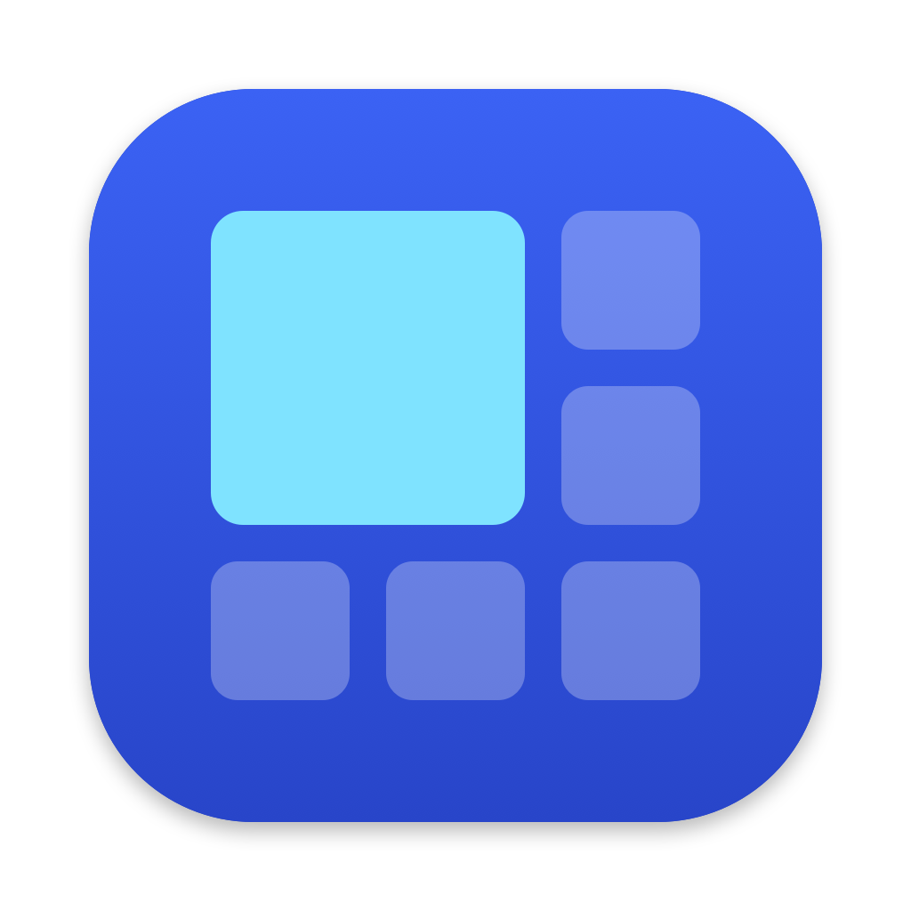
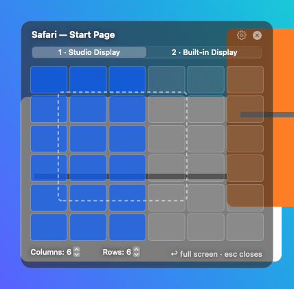
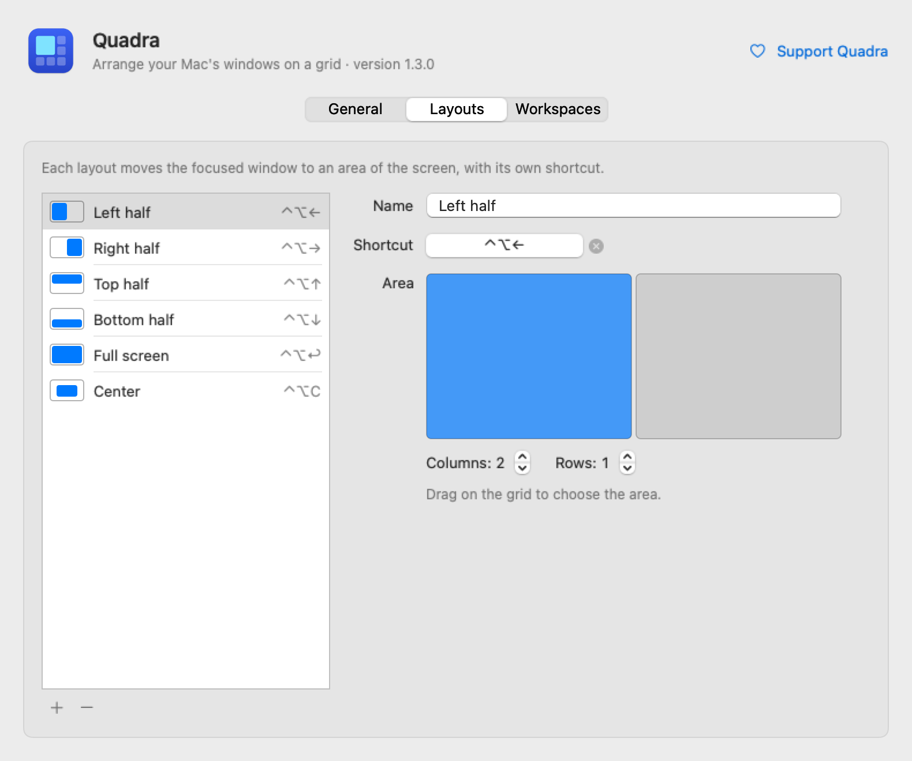

<p align="center">
  
</p>

<h1 align="center">Quadra</h1>

<p align="center">
  Arrange your Mac's windows on a grid. Free and open source.<br>
  <a href="README.pt-BR.md">Leia em português</a>
</p>

<p align="center">
  
</p>

Quadra is a menu bar app inspired by [Divvy](https://mizage.com/divvy/). Press a shortcut or
click the icon, drag across the grid, and the window moves to that area of the screen.

> **On Windows?** Quadra also runs on Windows 10 and 11: see [Quadra for Windows](Windows/README.md).

## Features

- **Drag on a grid** to pick any area, with 1 to 20 columns and rows.
- **See-through panel** in the middle of the screen, with a preview of where the window will land.
- **Click another window** while the grid is open to move that one instead.
- **Layouts with their own shortcuts**: save areas such as "left half" or "center" and apply them
  with one keystroke. Six ready-made layouts are included.
- **Multiple displays**: pick the display in the panel, or send a window to the next display.
- **Ultrawide friendly**, and works with portrait and laptop displays too.
- Adjustable gaps between windows, grid shape, size and opacity.
- In English and Brazilian Portuguese.

## Install

**With [Homebrew](https://brew.sh):**

```bash
brew install --cask ahrmichelon/tap/quadra
```

Then follow steps 2 and 3 below. To update later: `brew upgrade --cask quadra`.

**Or download it:**

1. Download `Quadra.zip` from the [latest release](https://github.com/ahrmichelon/quadra/releases/latest),
   unzip it and move **Quadra.app** to **Applications**.
2. Open it. Quadra is not notarized by Apple yet, so the first time macOS blocks it.
   Open **System Settings → Privacy & Security**, scroll down and click **Open Anyway**.
3. When asked, allow **Accessibility** (System Settings → Privacy & Security → Accessibility →
   turn on Quadra). Quadra needs it to move other apps' windows.

Requires macOS 14 Sonoma or later, on Apple silicon or Intel.

### Updates

Once a day Quadra asks GitHub whether a new version is out, and tells you when there is one
(you can turn this off in Settings). It's the only time Quadra uses the internet.

From version 1.1.0 on, macOS keeps the Accessibility permission when Quadra updates. Coming from
1.0.x, remove Quadra from the Accessibility list with **–** and add it again with **+** once.

## Use

| Shortcut | What it does |
|---|---|
| **⌃⌥G** or click the menu bar icon | Open the grid |
| Drag on the grid | Move the window to that area |
| **← → ↑ ↓** / **↩** (grid open) | Halves / full screen |
| **esc** | Close the grid |
| **⌃⌥← → ↑ ↓**, **⌃⌥↩**, **⌃⌥C** | Default layouts: halves, full screen, center |
| **⌃⌥⌘→** / **⌃⌥⌘←** | Move to the next / previous display |

Right-click the menu bar icon, or click the gear on the panel, for the menu. Every shortcut
can be changed in **Settings & Layouts**.

<p align="center">
  
</p>

## Build from source

You need macOS 14 or later and Xcode 15.3 or later.

```bash
git clone https://github.com/ahrmichelon/quadra.git
cd quadra
./build.sh --install   # builds build/Quadra.app, copies it to /Applications and opens it
swift test             # runs the tests
```

Open `Package.swift` in Xcode to work on the code.

| Folder | Contents |
|---|---|
| `Sources/Quadra` | The app |
| `Tests/QuadraTests` | Tests for the geometry, layouts and shortcuts |
| `App` | `Info.plist` and translations |
| `Branding` | Icon in every format, colors |
| `Tools` | Script that draws the icon |
| `Windows` | Quadra for Windows (C# and .NET), see [its README](Windows/README.md) |

## Contributing

Bug reports, ideas and pull requests are welcome, in English or Portuguese.
See [CONTRIBUTING.md](CONTRIBUTING.md).

## Support Quadra

Quadra is free. If it helps you, you can support it. The first goal is to pay for Apple's
Developer ID (US$ 99 per year), so macOS stops blocking the download.

**Pix** (Brazil): scan the code with your bank app, or use the key
`8483959a-77da-4767-ba1b-dde7eb4e1bd1`.


## License

[MIT](LICENSE)
